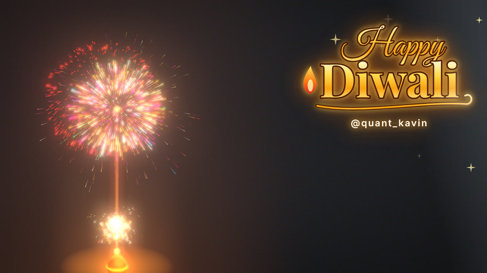
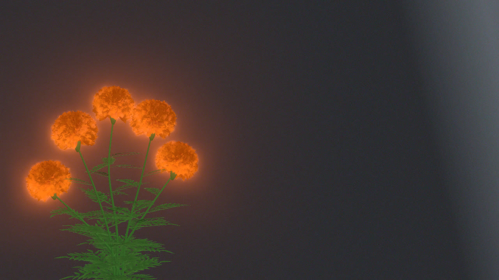

# Diwali AR Cam

Hand-controlled Diwali effects drawn live over your webcam, in the browser. Spread your hands to set off a glowing Diwali firework, or pinch to grow and bloom a marigold bush. Nothing to install: it runs in Chrome or Edge with a small local web server that is included.

| Diwali firework | Marigold bush |
|---|---|
|  |  |

Both effects sit on the left side of the frame so your face stays visible, and both can record straight to an .mp4.

## Requirements

- A webcam (a USB webcam is picked automatically over a laptop's built-in one)
- Chrome or Edge, recent version
- An internet connection on first load (Three.js, MediaPipe and the hand-tracking model come from public CDNs)
- Windows: nothing else. macOS or Linux: Python 3, which macOS and most Linux distributions already include

## Run it

The page needs camera access, and browsers only grant that to pages served from `localhost` or HTTPS. Opening `index.html` directly from the file system will not work.

**Windows**

1. Download the repo (Code > Download ZIP) and extract it. Do not run it from inside the zip preview.
2. Double-click `start.bat`. A console window opens and your browser goes to `http://localhost:8642`.
3. Pick a cam and click **Allow** when the browser asks for the camera.
4. Keep the console window open while you use it. Close it to stop.

If Windows shows "Windows protected your PC", click **More info > Run anyway**. `start.bat` only launches `serve.ps1`, a short static file server written in PowerShell that listens on `localhost` only.

**macOS / Linux**

1. Clone or download the repo.
2. Double-click `start.command`, or run `python3 -m http.server 8642` in the repo folder.
3. Open `http://localhost:8642` and allow the camera.

## Controls

### Diwali firework: spread your hands

| Hands | What happens |
|---|---|
| Holding each other | A small flame flickers on the anar (flower pot) |
| Pulling apart | A gold fountain lights, a launch trail rises and a sparkler bursts at the top. Height, size and spark count follow the distance between your palms |
| Arms wide | Colour shells go off in a Diwali palette (gold, saffron, pink, emerald, cyan, violet) and repeat while you hold, the room dims slightly, and a gold "Happy Diwali" title writes itself on beside you |
| Back together | Everything dies down to the flame |

### Marigold bush: pinch with each hand

| Hand | What happens |
|---|---|
| Left hand, thumb and index apart | **Grow**: stems rise, leaves unfurl, green buds form |
| Right hand, thumb and index apart | **Bloom**: petals push out of the buds, outer rows first, until each head is a full pompom |

If grow and bloom land on the wrong hands, set `pinch.swapHands: true` in `marigold/index.html`.

### Keys (both cams)

| Key | Action |
|---|---|
| Space | Start or stop recording. The video saves to your Downloads folder (.mp4 in Chrome and Edge) |
| C | Switch camera. Your choice is remembered |
| Left / Right arrows | Slide the effect sideways. Remembered per cam |
| Down arrow | Reset the effect to its default position |
| H | Status panel: live values, hand tracking state and the camera's actual resolution |
| D | Automatic cycle without hands, useful for framing a shot |
| 1 / 2 / 3, 0 | Hold the automatic cycle at its start, middle or end. 0 resumes it |
| S | Draw the full hand skeleton |
| Mouse | Drag to rotate, scroll to zoom, right-drag to pan. F5 resets the view |

## How it works

Every frame, MediaPipe Hand Landmarker finds up to two hands in the webcam image and returns 21 points per hand. Each cam turns those points into control values:

- **Firework**: the distance between the two palm centres, divided by the average hand length (wrist to middle knuckle). Dividing by hand length makes the value the same whether you sit close to the camera or far from it.
- **Marigold**: the gap between thumb tip and index tip on each hand, divided by that hand's length. MediaPipe's left/right label decides which hand drives grow and which drives bloom.

Values are smoothed over a fraction of a second to absorb tracking jitter, then drive the effect.

Rendering happens in three passes on one WebGL canvas:

1. The effect alone, on a transparent background, which gives its colour and an alpha mask.
2. The same effect through a bloom pass, which gives the glow.
3. A full-screen shader that draws the mirrored, cover-cropped webcam and lays passes 1 and 2 over it.

Drawing the webcam inside the shader, rather than as a `<video>` behind a transparent canvas, keeps the glow off the room, lets the recorder capture a single canvas, and allows an exact sRGB decode. Browsers deliver webcam frames already sRGB-encoded. Without the decode, the image is brightened twice and looks washed out. The firework treats its sparks as light: bright sparks replace the pixels behind them, so their colour stays saturated even in front of a white wall.

The firework is a particle system of up to 14,000 sparks. Each spark is drawn as a short streak along its velocity plus a soft dot at its head, with additive blending. A share of sparks split into smaller sparks as they die, which produces the crackle. The marigold bush is generated in code. Each flower head is about 300 ruffled, cupped petals placed on a Fibonacci spiral and drawn as one instanced mesh. Each leaf is a midrib with pairs of serrated leaflets merged into one mesh.

## Tech stack

| Layer | What | Used for |
|---|---|---|
| Rendering | [Three.js](https://threejs.org) 0.166 (WebGL2) | Scene, instanced meshes, line and point particles, custom GLSL compositing shader |
| Glow | Three.js `UnrealBloomPass` + `EffectComposer` | Bloom on the effect only, not the room |
| Hand tracking | [MediaPipe Tasks Vision](https://ai.google.dev/edge/mediapipe/solutions/vision/hand_landmarker) 0.10.14, Hand Landmarker (float16) | 21 landmarks per hand, up to 2 hands, GPU delegate with CPU fallback |
| Camera | `getUserMedia`, `VideoTexture` | 1080p30 request, external-webcam preference, continuous autofocus and exposure where supported |
| Text and overlays | Canvas 2D | Hand lines and labels, the "Happy Diwali" title with gradient, shimmer and glow |
| Recording | `MediaRecorder` + `canvas.captureStream` | Flattens the WebGL canvas and overlays into one .mp4 or .webm |
| Fonts | [Great Vibes](https://fonts.google.com/specimen/Great+Vibes), [Playfair Display](https://fonts.google.com/specimen/Playfair+Display) (SIL OFL) | Title lettering, bundled in `diwali/fonts/` |
| Local server | PowerShell `HttpListener` (Windows), Python `http.server` (macOS, Linux) | Serves the folder on `localhost` so the browser allows camera access |
| Language | Plain JavaScript ES modules, HTML, CSS | No build step, no npm install |

Libraries load from jsDelivr through an import map, and the hand model loads from Google's MediaPipe model storage. Camera frames are processed in your browser and are never uploaded.

## Customize it

Each cam has a `PARAMS` block near the top of its `index.html`. You can also edit `window.PARAMS` live from the browser console for some values.

**Firework** (`diwali/index.html`)

- `firework.maxRadius`: largest burst size. Lower it if bursts reach your face.
- `firework.palette`: shell colours. `firework.gold` sets the sparkler and fountain colours.
- `firework.shellAt`: how far apart your hands must be before shells start (0 to 1).
- `interaction.spreadMax`: lower it so you don't have to stretch as wide to reach full power.
- `night.dim`: how much the room darkens while it goes off. 0 turns it off.
- `title`: wording, handle, position (`x`, `y` as fractions of the screen), size, and when it appears (`showAt`, `hideAt`).

**Marigold** (`marigold/index.html`)

- `bush.tips`: one row per flower head, as x, y, z positions. Add or remove rows to change the number of flowers.
- `heads`: flower size, petal count, colours and glow.
- `leaves`: number and length of leaves.
- `bush.seed`: a different seed gives a different leaf and petal layout.

**Both**

- `view.screenShift`: where the effect sits horizontally. Negative values move it left.
- `feed`: requested camera resolution and frame rate, plus optional `sharpen`, `contrast` and `saturation`. The defaults (0, 1, 1) show exactly what the webcam sends.

## Troubleshooting

| Symptom | Fix |
|---|---|
| "Camera blocked" message | Open the page from `http://localhost:8642`, not by double-clicking the HTML file, and allow the camera in the address bar's site settings |
| Wrong camera, or low resolution in the status panel (H) | Press C to switch. Close other apps that use the webcam (Zoom, Teams, OBS, the Camera app), because Windows lets only one app use it at a time |
| Hand tracking shows "failed" in the status panel | Check your internet connection. The model downloads on first load. The page retries on the CPU if the GPU path fails |
| Nothing changes after editing a file | Press Ctrl+F5 to bypass the browser cache |
| Port 8642 already in use | Close the other console window that is running the server, then start again |

## Project layout

```
index.html          landing page that links to both cams
start.bat           Windows launcher (runs serve.ps1)
serve.ps1           tiny localhost-only static server
start.command       macOS / Linux launcher (python3 http.server)
shared/
  stage.js          renderer, bloom, webcam compositing shader, screen offset
  webcam.js         camera open, external-webcam preference, switching
  hands.js          MediaPipe loader, landmark-to-screen mapping, overlay helpers
  recorder.js       canvas + overlay recording to .mp4 / .webm
  app.js            start-up, keyboard shortcuts, status panel, frame loop
  base.css          shared layout
diwali/
  index.html        settings, hand-distance control, overlay, loop
  firework.js       particle firework
  title.js          "Happy Diwali" title
  fonts/            Great Vibes, Playfair Display (OFL)
marigold/
  index.html        settings, pinch control, overlay, loop
  bush.js           procedural marigold bush
```

## Credits

Inspired by [cupidbity/spiderlily](https://github.com/cupidbity/spiderlily), a hand-controlled spider lily built in TouchDesigner with a web version. This repo is an independent implementation.

Built by [@quant_kavin](https://www.instagram.com/quant_kavin/).

## License

Code: [MIT](LICENSE). Fonts in `diwali/fonts/`: SIL Open Font License, with their license texts in the same folder.
